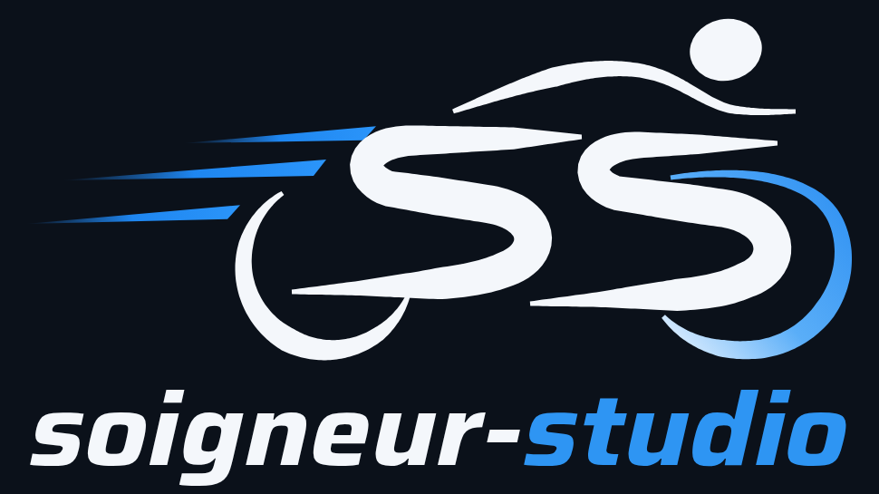
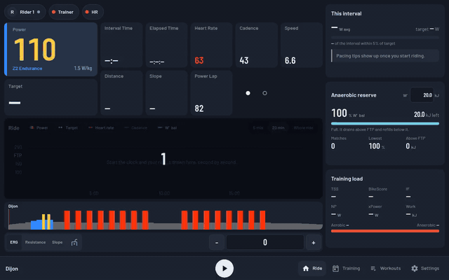

# Soigneur Studio

Indoor cycling and training, on your own server. Ride structured workouts on a smart trainer in the browser, over Bluetooth or ANT+, and keep your training, health data and plan together, for you and your household. One interface for every screen (phone, portrait or on the handlebars in landscape, tablet, laptop, PC and TV), in dark and light.

Soigneur Studio is based on [Auuki](https://github.com/dvmarinoff/Auuki) by Dimitar Marinov, which provides the trainer and sensor engine; see [Credits and licence](#credits-and-licence).

**Walkthrough**: [a tour of every page with screenshots](docs/walkthrough/README.md) and a [44-second screencast](docs/walkthrough/walkthrough.mp4).

<a href="docs/walkthrough/README.md"></a>

**The Ride page**
* **One layout from phone to TV**: power as a large tile that takes the colour of your current power zone (with zone name and live W/kg), the other metrics in a grid of tiles, connections in a slim header and one bottom bar for the ride controls and the pages (Ride, Training, Workouts, Settings).
  * *Screens*: swipe between Ride screens (dots and ← → too); you choose the tiles, their order and size in Edit layout (see *Your own layout* below).
  * *Phone, portrait*: the statistics panels are swiped one at a time. While a ride runs, the bottom bar shows only the ride controls; the pages are behind the menu button.
  * *Phone, landscape* (on the handlebars; replaces the old dock mode): the tiles of the screen that fit, and the ERG / resistance / slope controls; swipe for the next screen.
  * *Tablet, desktop and TV*: more columns, statistics side by side, scaled up on large screens.
* **Live ride chart**: power coloured by zone, target power, heart rate and cadence, with 5 min, 20 min or whole-ride views, a hover read-out and series toggles. Your choices are remembered.
* **Live training statistics**:
  * *This interval*: average power against target, the share of time within 5 % of target, and pacing cues ("Above target by 20 W — ease off", low cadence under load, heart-rate drift)
  * *Training load*: TSS, intensity factor, normalized power, work (kJ)
  * *Power*: average, max, average W/kg, variability index
  * *Heart*: average, max, efficiency factor (NP/HR), power:HR decoupling
  * *Time in zone*: the app's 7 zones (Recovery to Anaerobic), using your FTP
  * *Best efforts*: 5 s, 1 min, 5 min and 20 min in W and W/kg
* **GoldenCheetah metrics** (same formulas as GoldenCheetah's `src/Metrics`):
  * *Anaerobic reserve*: live W′bal (Skiba differential model), time until W′ is empty at the current power, matches burned (efforts above FTP costing ≥ 2 kJ), lowest W′bal, work above FTP. W′ is editable in the panel (default 20 kJ, as in GoldenCheetah); FTP is used as CP, or the rider model's CP and W′ when you choose them.
  * *Training load*: BikeScore and xPower next to TSS and NP, plus the aerobic / anaerobic split from Skiba's TISS.
  * W′bal line on the ride chart, and peak power for 5 s, 30 s, 1, 5, 10, 20 and 60 min.
* Light and dark theme, 4K / TV scaling, and statistics rebuilt from the recorded session after a page reload.
* **Works offline**: once opened over HTTPS (or `http://localhost:8080`), the app is kept on the device and starts without a connection. Rides, plan changes, ratings and settings are kept on the device and sync with your account when the connection returns; the rider menu shows *Offline* and how many rides are waiting. Online you always get the newest build. Not offline: opening Garmin or intervals.icu rides for analysis (your server fetches those) and new data from those services.

* **Readiness**: every morning *Ready*, *Take care* or *Rest*, with the reasons (HRV against your range, resting heart rate, sleep, Body Battery, form). Before a hard planned workout on a bad morning the Ride page offers to ride it easier, swap it for a recovery spin, or move it, with Undo.
* **Rider model**: CP and W′ fitted from your best 2–20 minute efforts of the last 90 days, drawn over the power curve, and used for W′bal when you say so (or automatically); a power profile (5 s, 1 min, 5 min, FTP in W/kg) with a category for each. FTP is never changed by the model.
* **Built-in tests**: *3 + 12 min* (CP and W′), *Ramp*, *20 min* and *2 × 8 min* (FTP), and *Sprint* (peak and 5 s power) in the Workouts library. All-out efforts run in sim mode at 1 %, so the power is yours; the Ramp ends by itself when you can't hold the target. When the test ends a result screen offers *Use for W′bal* or *Use as FTP*: nothing changes without a tap. The CP and W′ card offers the 3 + 12 min test when an effort is missing.
* **Ride analysis**: open any ride (Soigneur, Garmin, intervals.icu or an imported `.fit`) on its own page: the whole ride on an interactive chart, its intervals with planned against actual per rep, decoupling and efficiency, W′bal with each match, durability, best efforts and time in zones. Garmin and intervals.icu rides are fetched by your account server when you open them.
* **Your own layout**: several Ride screens to swipe between (Ride, Big numbers, Chart to start), and an Edit layout mode on Ride and Training to move, size, add and remove tiles and cards. Separate layouts for phones and larger screens, synced through your account.

**Training page.** Your riding at a glance, on every screen size:
* *Form*: fitness (42-day), fatigue (7-day) and form, over 3 months, a year or all your history, and a 4-week forecast from your plan.
* *Interactive charts* (on [uPlot](https://github.com/leeoniya/uPlot)): hover or touch for a read-out (values, and the ride or effort behind them), drag to zoom, click a day to open it. Form and health share their cursor.
* *Calendar*: your rides and planned workouts per week (phone) or month. Tap a day to see its rides, plan a workout from your library, or move or remove a planned one. Planned workouts show as planned, done (planned vs. actual TSS) or missed.
* *Riding the plan*: on a day with a planned workout, the Ride page selects it when the app opens (not over a workout you picked yourself that day, and never during a ride). A saved ride is matched to that day's plan.
* *Progress*: weekly volume (hours, TSS, kJ), power curve from 1 s to 2 h (last 6 weeks vs. all time, W or W/kg), FTP trend (estimated from your best 20 and 60 minutes, with a button to update your FTP when it's more than 5 % off) and time in zones per week or month.
* Every saved ride keeps a small summary, also when the device trims old `.fit` files. Rides from before this version are read back from their `.fit` the first time you open Training, from this device or from your account. Signed in, the plan and summaries sync through your account server.
* *intervals.icu*: with intervals.icu connected, the account server brings in your activities from there (the last 2 years, then every 15 minutes): outdoor rides, rides from other apps, and other sports. All sports count for form and weekly volume and show on the calendar with their sport; power curve, FTP and zones use cycling only. A ride recorded in Soigneur and also on intervals.icu (Soigneur's own upload, or a head unit that recorded the same ride) counts once. Missed one? *Hide this ride* in the day dialog (undo with *Show*) on any ride.
* *Plan, both ways*: workouts planned on intervals.icu appear on the calendar (tagged *intervals.icu*) and can be ridden; workouts planned in Soigneur appear on intervals.icu. Moving or removing on either side follows on the other; when both changed, the newer change wins.
* *Garmin*: with your own Garmin Personal API key (Garmin Connect on the web, Settings, Personal API Key), the account server brings in your health data every 15 minutes: overnight HRV, resting heart rate, sleep, Body Battery, stress, weight and VO2max, 90 days back at first. Your Garmin activities come in too (2 years back), as a second source next to intervals.icu; a ride that arrives from several sources counts once (Soigneur's own recording first, then Garmin, then imported `.fit`, then intervals.icu).
* *Health card*: last night's HRV against your normal range (Garmin's baseline, or your own 60 days), resting heart rate against its 30-day average, sleep and Body Battery, with 60 days of HRV and resting heart rate.
* *A load for every workout*: power when there is power; otherwise heart rate against your threshold heart rate for the sport (set it under Settings, or Garmin's is used); otherwise how hard you said it was (tap 1–10 in the day dialog); otherwise an estimate from the sport and duration. The calendar marks loads that aren't from power with **HR**, **RPE** or **est.**
* Not available through intervals.icu: activities that came from Strava (intervals.icu's API returns them empty; the account card counts them), and possibly Garmin's (intervals.icu expects to block API access to them). *Import .fit files* on the Training page adds such rides from their `.fit` files (several at once; files already there are skipped).
* Development: `?simulate&history` on `npm start` fills a rider with 4 months of generated rides, runs from intervals.icu and a plan.

**More workout files.** Load several at once from the Workouts page:
* `.zwo` Zwift workouts (also when saved as `.xml`)
* `.erg` (watts) and `.mrc` (percent of FTP) from TrainerRoad, GoldenCheetah, PerfPRO and others, including `[COURSE TEXT]` cues
* `.txt` intervals.icu workout text: `- 10m ramp 50-75% 85rpm`, `Main set 5x`, `200w`, `Z2`, `1m30s`, cues as free text
* `.fit` courses (as before)

Extensions are case-insensitive. Files that can't be read are listed in an error message, and the other files still load.

New files: `src/analytics.js` (the statistics, tested in `test/analytics.test.js`), `src/workouts/formats.js` (workout formats, tested in `test/workout-formats.test.js`), `src/views/training-dashboard.js` (chart and statistics panels).

**Design system** (`src/css/`): `tokens.css` (every colour, size and font, dark and light), `base.css` (page shell, bottom bar), `components.css` (buttons, cards, tiles, tabs, fields, dialogs, the workout graph) and one layout file per page: `ride.css`, `training.css`, `workouts.css`, `settings.css`, `rider-menu.css`. Page files only arrange components and use tokens. `npm run check:visual` (with `npm start` running; set `CHROME_PATH` if Playwright's own Chromium isn't installed) opens every page at phone, tablet and desktop sizes in both themes and fails on sideways scrolling, tap targets under 44 px on phones, text overflowing its tile and console errors; screenshots go to `test/visual/out/`.

**Compared with Auuki**: the original layout and its stylesheet, dock mode, the auuki.com account and its Settings connections (intervals.icu, Strava, TrainingPeaks through Auuki's server), the intervals.icu planned list and the Ride Report tab are gone. Accounts and connected services are in the rider menu, through your own server. Rides recorded on a device stay under *Workouts → Your rides* for download.

Run it locally with `npm install` then `npm start`, and open the printed address in Chrome or Edge. Web Bluetooth needs `localhost` or HTTPS. For accounts in development, run `npm run server` in a second terminal; the Parcel dev server forwards `/api` to it (`.proxyrc.json`). Server tests: `npm run test:server`.

No trainer at hand? Open the dev server with `?simulate` (e.g. `http://localhost:1234/?simulate`) and a simulated rider feeds power, cadence, speed and heart rate into the app. It follows the ERG target, a badge shows it is on, and it only exists on `npm start`, never in production builds or Docker. Don't upload rides recorded this way to Strava or intervals.icu.

**Riders, accounts and saved sensors.** The rider pill at the top left of the home screen opens a panel with:
* *Riders*: several riders on one device, each with their own FTP, weight, W′, workouts, rides and saved sensors. Switching reloads the app with that rider's data.
* *Account*: sign in to the self-hosted account server (part of the Docker setup) to sync FTP, weight, W′, imported workouts and every saved ride across devices, without the 7-ride limit. The first account becomes the admin.
* *Sensors*: the last trainer, heart-rate strap, power meter and other sensors per rider. With Chrome's persistent Bluetooth permissions (`chrome://flags/#enable-web-bluetooth-new-permissions-backend`) they reconnect when the app opens, without the device list.
* *Ride history*: all rides on your account, with `.fit` download, upload status per service, and *Send to Strava / intervals.icu / Garmin*.
* *Connected services* (under *Account*), per rider:
  * **Strava**: *Connect with Strava*; new rides upload automatically to the rider's own Strava. Needs one Strava API app for the server (`PUBLIC_URL`, `STRAVA_CLIENT_ID`, `STRAVA_CLIENT_SECRET`; see `.env.example`). New Strava apps start with a limit of 1 connected athlete until Strava raises it.
  * **intervals.icu**: paste the personal API key; new rides upload automatically, and activities and planned workouts sync with the Training page (status and *Sync now* on the card).
  * **Garmin Connect**: paste your Personal API key to bring in health data and activities (read-only; the key is for the account holder's own data and stays on the server; you get a warning a week before it expires). Garmin's upload API is for approved businesses only, so *Send to Garmin* downloads the `.fit` and opens Garmin's import page.
  * Uploads retry after 30 s, 5 min and 30 min; tokens and keys stay on the server.
* *Users* (admins): create accounts, reset passwords, change roles, disable or delete accounts.

## Run with Docker

The container only serves the web page. Bluetooth and ANT+ still run in Chrome or Edge on the computer you ride with, so Docker does not affect them. Your trainer, heart-rate strap and ANT+ USB stick connect to that computer, not to the Docker host. The browser only allows Bluetooth and USB on a secure page: `https://…` or `http://localhost`.

```sh
docker compose up -d --build
```

This starts two containers: `soigneur-studio` (Caddy serving the app; compose service `auuki`) and `soigneur-studio-api` (the account server; service `api`, data in the `api-data` volume). Open the app, click the rider pill, and create the first account under *Account*; it becomes the admin. Set `ALLOW_SIGNUP=true` to let riders create their own accounts.

* **Riding on the same machine:** open `http://localhost:8080`. No certificate needed.
* **Riding on another device** (Docker on a notebook or NAS, riding on a PC or Android phone): start it with the address the other devices use, then open `https://<that address>:8443` there.

  ```sh
  echo SOIGNEUR_HOST=192.168.1.20 >> .env
  docker compose up -d --build
  ```

  Put the address in a file named `.env` next to `docker-compose.yml` (`SOIGNEUR_HOST=192.168.1.20`), so later rebuilds keep it; without it the certificate is made for `localhost` only and other devices get *ERR_SSL_PROTOCOL_ERROR*. (`AUUKI_HOST`, the name before the rename, still works.) Use that same address in the browser.

  Then make each riding device trust Caddy's root certificate. Without it the browser shows the address as not secure, the app can't be installed and Bluetooth doesn't work. You do this once per device: the certificate stays in the `caddy-data` volume across rebuilds and lasts 10 years.

  **Android phone or tablet:**
  1. In Chrome, open `http://<that address>:8080/soigneur-root.crt` (note: `http` and port 8080). This downloads `soigneur-root.crt`.
  2. *Settings → Security → Encryption & credentials → Install a certificate →* **CA certificate** (the menu names differ a little per brand; search Settings for "certificate"). Confirm *Install anyway* and pick the file. Not *VPN & app user certificate* or *Wi-Fi certificate*: Chrome ignores those.
  3. Check: *Encryption & credentials → Trusted credentials →* tab **User** lists *Caddy Local Authority - 2026 ECC Root*.
  4. *Settings → Apps → Chrome →* **Force stop**: Chrome reads trusted certificates only when it starts. Then open `https://<that address>:8443`; the address is no longer red, and the Chrome menu offers *Install app*.

  **Windows:** download the file the same way (or copy it with `docker compose cp auuki:/data/caddy/pki/authorities/local/root.crt ./soigneur-root.crt`), double-click it, *Install Certificate → Local Machine →* place it in **Trusted Root Certification Authorities**, and restart the browser.

  To check you have the right certificate: its name is *Caddy Local Authority - …*, and its SHA-256 fingerprint matches `openssl x509 -in soigneur-root.crt -noout -fingerprint -sha256` on the Docker machine. Only the public certificate is offered for download; its private key never leaves the container.
* **Quick test without a certificate**, one PC only: in Chrome open `chrome://flags/#unsafely-treat-insecure-origin-as-secure`, add `http://<host>:8080`, and relaunch Chrome.

* **Updating from Auuki Desktop:** `docker compose up -d --build` replaces the containers (now named `soigneur-studio` and `soigneur-studio-api`); accounts, rides and certificates stay, because the data volumes keep their names.

## Browsers and trainers

**Browsers.** Bluetooth in the browser needs a Chromium browser: Chrome, Edge, Opera, Samsung Internet or Brave (enable it in Brave's settings first), on Windows, macOS, Linux or Android. Firefox and Safari, and every browser on iOS, have no Web Bluetooth. On Linux, Chrome and Edge may need `chrome://flags/#enable-experimental-web-platform-features` (or `edge://…`). ANT+ uses a USB stick through Web Serial and is experimental.

**Trainers.** Smart trainers that speak the Bluetooth Fitness Machine Service (FTMS), Tacx trainers over FE-C on Bluetooth, Wahoo trainers over their own protocol, and ANT+ FE-C trainers through a USB stick. Most smart trainers from 2020 onwards support FTMS. Power meters, heart-rate straps, speed and cadence sensors, Moxy and CoreTemp connect over Bluetooth.

## Credits and licence

Soigneur Studio is based on [Auuki](https://github.com/dvmarinoff/Auuki) by Dimitar Marinov (dvmarinoff), imported in November 2026 and developed separately since. Auuki provides the trainer and sensor engine (Bluetooth, ANT+), the FIT file format and the data models; the interface, the design system, the Training page and the account server were written for Soigneur Studio. It is not made or supported by the Auuki project. See [NOTICE](NOTICE).

Free software under the [GNU AGPL-3.0](LICENSE.txt). If you run a modified version on a server that others use over a network, offer them its source code.
