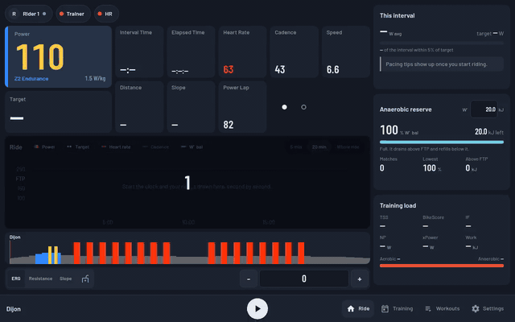
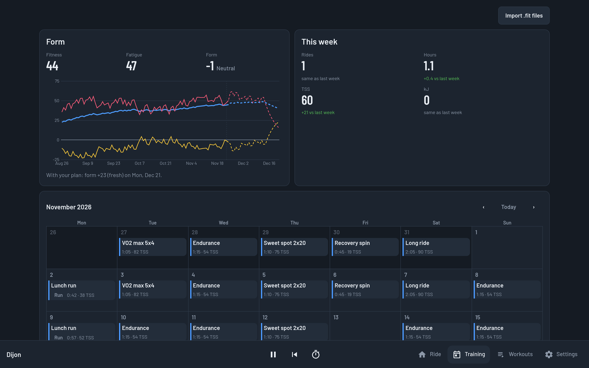
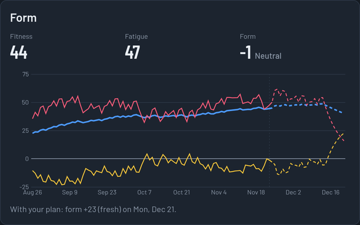
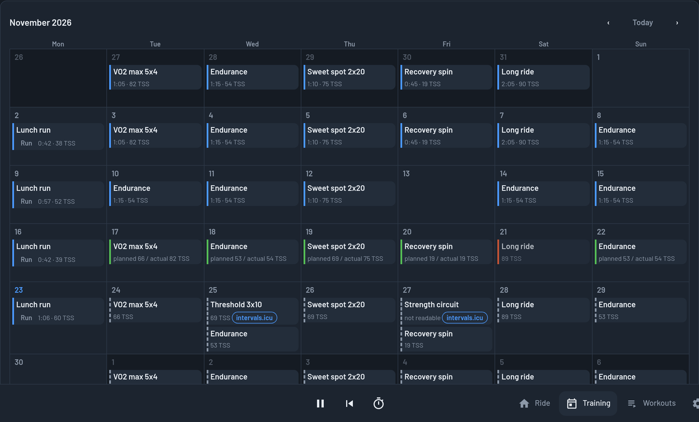
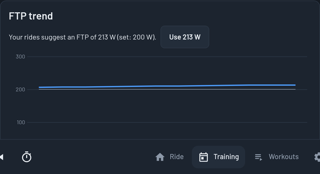
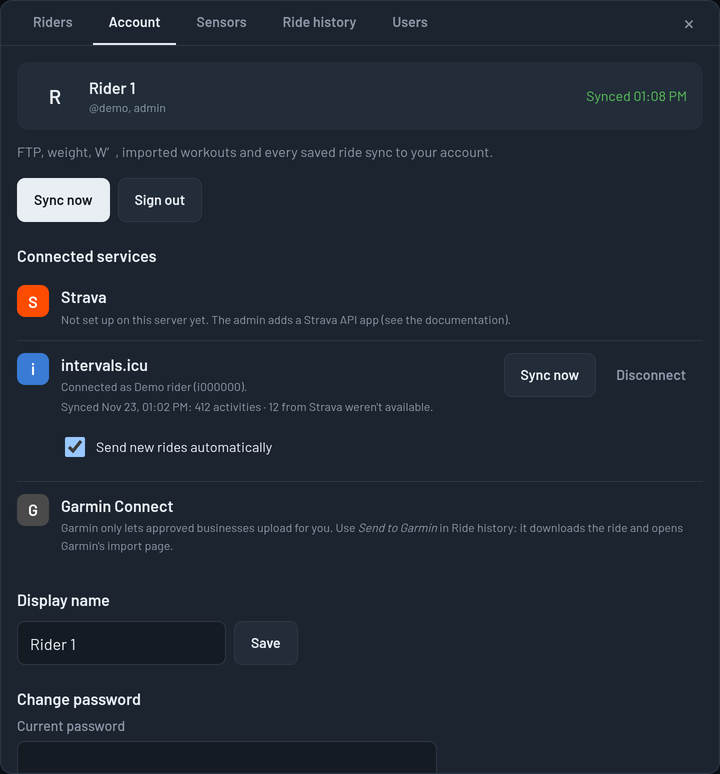
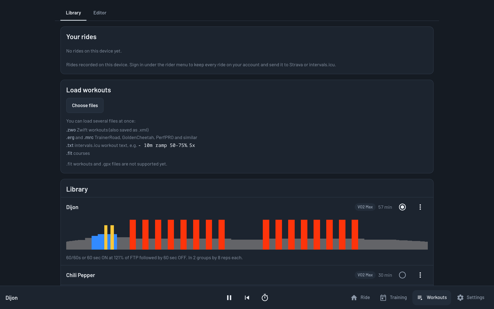
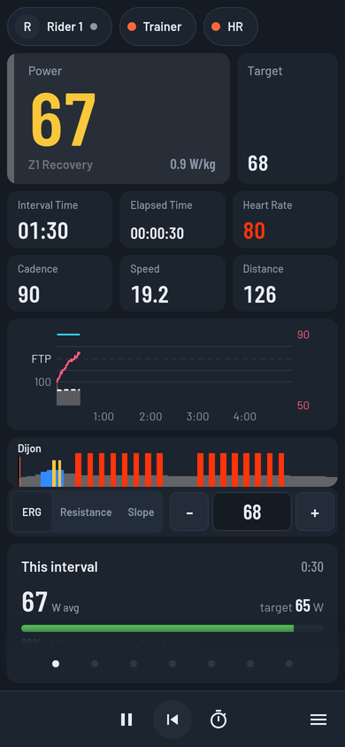

# Auuki Desktop: a walkthrough

A tour of what the app does, page by page. Click a picture to see it full size. The screenshots and the screencast come from the development build with a simulated rider and four months of generated training (`?simulate&history`), so every number in them is made up.

**Screencast** (44 s): [walkthrough.mp4](walkthrough.mp4). It covers riding a workout, the Training page (form, calendar, planning a workout, progress), the workout library and the rider menu.

<a href="img/walkthrough.gif"></a>

Contents: [Getting started](#getting-started) · [Ride](#ride) · [Training](#training) · [intervals.icu](#intervalsicu) · [Workouts](#workouts) · [Riders and accounts](#riders-and-accounts) · [Settings](#settings) · [Phones](#phones) · [Light theme](#light-theme) · [Updating these pictures](#updating-these-pictures)

---

## Getting started

1. Open the app in Chrome or Edge, either from Docker (`http://localhost:8080`, or `https://<host>:8443` from another device) or from `npm start`. Bluetooth needs `localhost` or HTTPS.
2. Connect the trainer and heart-rate strap with the pills at the top left (**Trainer**, **HR**). Saved sensors reconnect by themselves the next time.
3. Pick a workout on the **Workouts** page, or let the plan pick today's workout for you.
4. Press **▶** in the bottom bar. The app counts down, then controls the trainer.

Without a trainer, `npm start` with `?simulate` in the address gives you a simulated rider that follows the ERG target.

## Ride

<a href="img/ride-desktop.png"></a>

- **Power** is the big tile. It takes the colour of your current power zone and shows the zone name and live W/kg. **Target** is next to it.
- **The metric tiles** show interval time, elapsed time, heart rate, cadence, speed, distance, slope and lap power. The two dots switch between tile sets.
- **The live chart** shows power by zone, target, heart rate, cadence and W′bal. Each series can be switched on or off, and it can show the last 5 min, the last 20 min or the whole ride.
- **The workout graph** below the chart shows where you are in the workout.
- **The controls** switch between ERG, resistance and slope, with − / + for the target.
- **The sidebar statistics:**
  - *This interval*: average against target, time within 5 % of target, and pacing tips
  - *Anaerobic reserve*: W′bal, matches burned, the lowest point, work above FTP
  - *Training load*: TSS, IF, NP, BikeScore, xPower, work, and the aerobic / anaerobic split
  - *Power*, *Heart*, *Time in zone* and *Best efforts*

## Training

<a href="img/training-desktop.png"></a>

### Form

<a href="img/training-form.png"></a>

- **Fitness** (42-day load), **fatigue** (7-day load) and **form** (fitness minus fatigue), over the last 90 days.
- **The dashed part** is a 4-week forecast from your planned workouts. The line below the chart tells you where your plan takes you, for example "form +23 (fresh) on Mon, Dec 21".

### This week

Rides, hours, TSS and kJ so far this week, against the same days of last week.

### Calendar

<a href="img/training-calendar.png"></a>

- **Rides** have a solid bar. Rides from other sports carry a label, such as **Run**.
- **Planned workouts** have a dashed bar and show their planned TSS.
- **After the day**, a planned workout shows *planned 66 / actual 82 TSS* when you rode it (green), or red when you missed it.
- **Workouts planned on intervals.icu** carry an **intervals.icu** tag. One whose workout file can't be read shows *not readable*.
- **Phones** get a week list instead of the month grid ([see below](#phones)).

### A day

Click or tap a day to open it:

<a href="img/day-dialog.png"></a>

- **The day's rides.** **Hide this ride** takes one out of every count without deleting it, which is useful for a duplicate the app didn't catch. It stays listed, greyed, with **Show** to bring it back.
- **The day's planned workouts.** Move them with the date field, or remove them.
- **Plan a workout.** Search your library and pick one. It shows up on the calendar right away, counts in the form forecast, and, with intervals.icu connected, appears there too.

On the day of a planned workout, the Ride page selects it when the app opens. It never does so over a workout you picked yourself that day, or during a ride. A saved ride is matched to that day's plan.

### Progress

| | |
|---|---|
| <a href="img/progress-volume.png"></a> | <a href="img/progress-curve.png"></a> |
| <a href="img/progress-zones.png"></a> | <a href="img/progress-ftp.png"></a> |

- **Weekly volume**: hours, TSS or kJ for the last 12 weeks.
- **Power curve**: your best 5 s, 1, 5, 20 and 60 min over the last 6 weeks against all time, in W or W/kg.
- **Time in zones**: per week or per month.
- **FTP trend**: estimated from your best 20 and 60 minutes. When the estimate is more than 5 % off your FTP, the card offers to update it ("Use 213 W").

### Import .fit files

**Import .fit files** (top right of the Training page) adds rides recorded somewhere else, for example a Garmin export. Pick several files at once. Files already on the calendar are skipped, and files that can't be read are listed. Signed in, imported rides reach your other devices too.

## intervals.icu

Connect intervals.icu under *rider menu → Account* with your personal API key (intervals.icu → Settings → Developer Settings). The account server then does three things:

- **Uploads every new ride** to intervals.icu.
- **Brings in your activities**: the last 2 years on the first sync, then every 15 minutes. That covers outdoor rides, rides from other apps, and other sports.
  - All sports count for form, weekly volume and the calendar.
  - Power curve, FTP and zones use cycling only.
  - A ride recorded in Auuki that is also on intervals.icu counts once. That holds whether it is Auuki's own upload or a head unit that recorded the same ride, which the app recognises when the two overlap for at least 80 %.
- **Keeps the plan the same on both sides.**
  - A workout planned on intervals.icu appears on the Training calendar and can be ridden.
  - A workout planned in Auuki appears on intervals.icu.
  - Moving or removing a workout on one side follows on the other. When both sides changed it, the newer change wins.

<a href="img/account.png"></a>

The card shows when it last synced, how many activities came in, and how many weren't available. Activities that reached intervals.icu from Strava come back empty through its API, so the card counts them instead. For those rides, use **Import .fit files**. **Sync now** starts a sync right away.

> The card in this screenshot is shown connected with a sample status. The walkthrough doesn't use a real intervals.icu account.

## Workouts

<a href="img/workouts-desktop.png"></a>

- **The library** lists each workout with its type, duration and graph. Pick one with the round button; the ⋮ menu has more.
- **Load workouts** takes several files at once: `.zwo` (also as `.xml`), `.erg`, `.mrc`, intervals.icu workout text (`.txt`) and `.fit` courses. Files that can't be read are listed, and the rest still load.
- **The editor** builds your own workouts.
- **Your rides** lists the rides recorded on this device, for download.

## Riders and accounts

The rider pill at the top left opens the rider menu:

<a href="img/riders.png"></a>

- **Riders**: several riders on one device, each with their own FTP, weight, W′, workouts, rides and sensors.
- **Account**: sign in to your own account server (part of the Docker setup). That syncs your settings, workouts, rides, plan and hidden rides across devices. It also connects Strava, intervals.icu and Garmin Connect (*Send to Garmin* downloads the ride and opens Garmin's import page).
- **Sensors**: the saved trainer, heart-rate strap and other sensors, which reconnect by themselves.
- **Ride history**: every ride on the account, with `.fit` download, upload status per service and *Send to…*.
- **Users** (admins only): create accounts, reset passwords, change roles.

## Settings

<a href="img/settings-desktop.png"></a>

- **The profile**: FTP, weight and the theme (dark, light or auto).
- **Every kind of sensor**: trainer, power meter, heart rate, Moxy, CoreTemp and more. Each one has its own switches for which data it provides.

## Phones

| Ride | Training | Calendar |
|---|---|---|
| <a href="img/ride-phone.png"></a> | <a href="img/training-phone.png"></a> | <a href="img/training-phone-calendar.png"></a> |

- **Riding on a phone**: everything you need fits on one screen, and the statistics below are swiped one at a time.
- **On the handlebars in landscape**: power, target, six metrics, the chart and the controls.
- **Training on a phone**: the calendar becomes a week list, so it stays readable.

## Light theme

<a href="img/training-desktop-light.png"></a>

Every page has a dark and a light version. *Auto* follows the system.

## Updating these pictures

With `npm start` running, and the account server pointing at a scratch database, because the script signs up a demo account:

```sh
DATA_DIR=/tmp/auuki-demo npm run server     # in a second terminal
CHROME_PATH=/path/to/chrome node docs/walkthrough/capture.js
```

The script writes `img/*.png`, `walkthrough.mp4` and `img/walkthrough.gif` (it needs `ffmpeg`). Use `--only shots` or `--only video` for one of them, and `--url` when the dev server runs on another port.
