# Soigneur Studio: a walkthrough

A tour of what the app does, page by page. Click a picture to see it full size. The screenshots and the screencast come from the development build with a simulated rider and four months of generated training (`?simulate&history`), so every number in them is made up.

**Screencast** (44 s): [walkthrough.mp4](walkthrough.mp4). It covers riding a workout, the Training page (form, calendar, planning a workout, progress), the workout library and the rider menu.

<a href="img/walkthrough.gif"></a>

Contents: [Getting started](#getting-started) · [Ride](#ride) · [Screens and Edit layout](#screens) · [Training](#training) · [Ride analysis](#ride-analysis) · [intervals.icu](#intervalsicu) · [Garmin](#garmin) · [Workouts](#workouts) · [Riders and accounts](#riders-and-accounts) · [Settings](#settings) · [Phones](#phones) · [Light theme](#light-theme) · [Updating these pictures](#updating-these-pictures)

---

## Getting started

1. Open the app in Chrome or Edge, either from Docker (`http://localhost:8080`, or `https://<host>:8443` from another device, which must trust the server's certificate first: see [Run with Docker](../../README.md#run-with-docker) in the README) or from `npm start`. Bluetooth needs `localhost` or HTTPS.
2. Connect the trainer and heart-rate strap with the pills at the top left (**Trainer**, **HR**). Saved sensors reconnect by themselves the next time.
3. Pick a workout on the **Workouts** page, or let the plan pick today's workout for you.
4. Press **▶** in the bottom bar. The app counts down, then controls the trainer.

Without a trainer, `npm start` with `?simulate` in the address gives you a simulated rider that follows the ERG target.

## Ride

<a href="img/ride-desktop.png">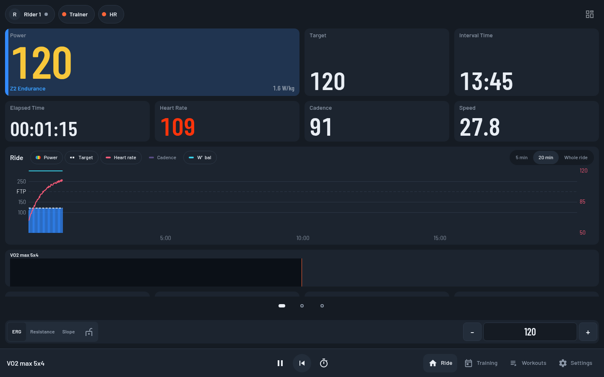</a>

- **Power** is the big tile. It takes the colour of your current power zone and shows the zone name and live W/kg. **Target** is next to it.
- **The metric tiles** show interval time, elapsed time, heart rate, cadence and speed; tap a tile to see its other values (3 s power, lap and average power, average and max heart rate…). Distance, slope, Moxy and CORE tiles can be added in Edit layout.
- **The live chart** shows power by zone, target, heart rate, cadence and W′bal. Each series can be switched on or off, and it can show the last 5 min, the last 20 min or the whole ride.
- **The workout graph** below the chart shows where you are in the workout.
- **The controls** switch between ERG, resistance and slope, with − / + for the target.
- **The sidebar statistics:**
  - *This interval*: average against target, time within 5 % of target, and pacing tips
  - *Anaerobic reserve*: W′bal, matches burned, the lowest point, work above FTP
  - *Training load*: TSS, IF, NP, BikeScore, xPower, work, and the aerobic / anaerobic split
  - *Power*, *Heart*, *Time in zone* and *Best efforts*

### Screens

| | |
|---|---|
| <a href="img/ride-big-numbers.png">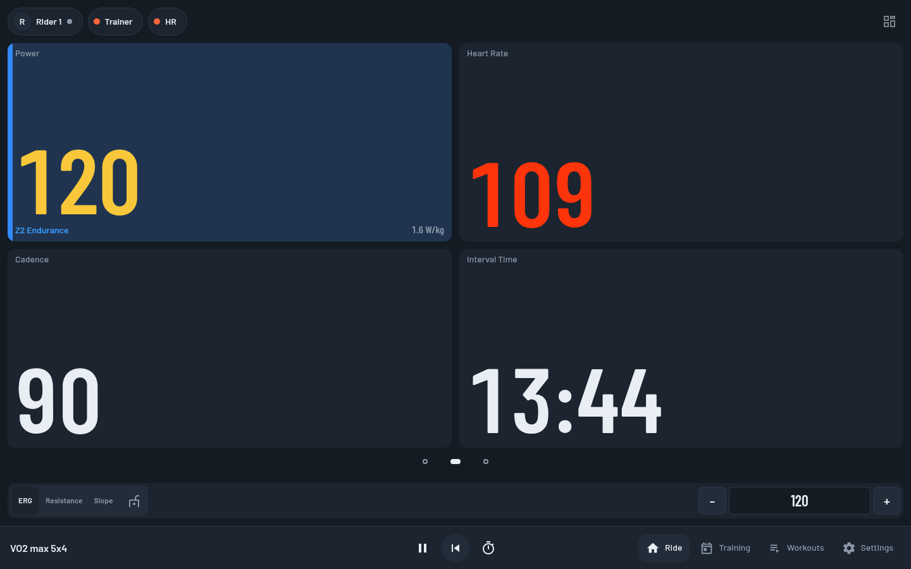</a> | <a href="img/ride-phone-big.png">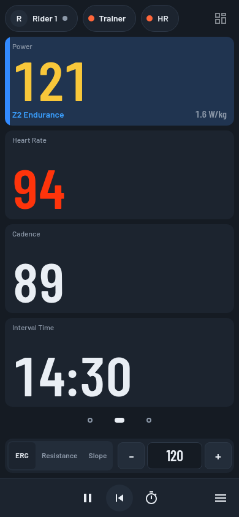</a> |

- **Swipe** left or right to the next screen, or tap the dots under the tiles (← → on a keyboard). The controls and the bottom bar stay put.
- **Three screens to start:** *Ride* (everything, as above), *Big numbers* (power, heart rate, cadence and interval time, as large as the screen allows) and *Chart* (the live chart full size).
- **On the live chart** a sideways finger moves the chart's read-out; swipe from the screen's edge to change screens there.
- The app remembers which screen you were on, per device.

### Edit layout

<a href="img/ride-edit.png">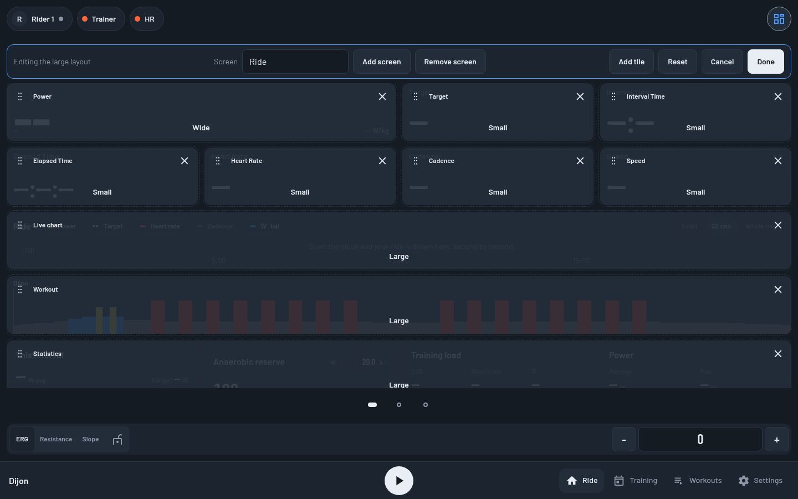</a>

The layout button at the top right (next to the connections) opens Edit layout. It is off while you ride: stop the clock first.

- **Move** a tile by its handle (⠿). With a mouse, drag at once; with a finger, hold the handle a moment, then drag. With a keyboard: focus the handle, then the arrow keys. Drop a tile on the screen's left or right edge to move it to the screen next to it.
- **Size:** the button in the middle switches between *Small*, *Wide* and *Large* (the live chart, workout and statistics: *Wide* and *Large*). Numbers grow with their tile.
- **Remove** with ×; **Add tile** lists every tile that isn't on this screen, including distance, slope, lap power, SmO2, THb and core and skin temperature. A tile can be on several screens.
- **Screens:** rename the screen in view, *Add screen* (up to 8), *Remove screen*, and drag a dot to move a screen (or Shift + ← / → on the dot).
- **Done** saves, **Cancel** throws the changes away, **Reset** goes back to the three built-in screens.
- Phones (and the phone on the handlebars) have their own layout; tablets, desktops and TVs share the other. Signed in, your layouts follow you to every device.
- **On the handlebars** (a phone in landscape) a screen shows the tiles that fit; put the rest on another screen.

## Training

<a href="img/training-desktop.png"></a>

### Form

<a href="img/training-form.png"></a>

- **Fitness** (42-day load), **fatigue** (7-day load) and **form** (fitness minus fatigue), over the last 3 months, a year or all your history.
- **The dashed part** is a 4-week forecast from your planned workouts. The line below the chart tells you where your plan takes you, for example "form +23 (fresh) on Mon, Dec 21".

### Reading the charts

<a href="img/training-readout.png">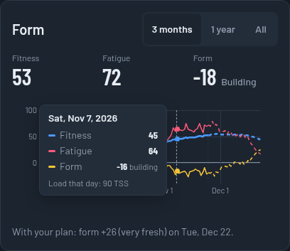</a>

Every chart on the Training page answers the mouse (or a finger on a phone):

- **Hover** for a read-out of that day, week or duration: the values, and where they came from (the ride behind a power-curve record, the effort behind an FTP estimate, the planned workout on a forecast day).
- **Drag** across a chart to zoom in; **double-click** to zoom out. The buttons above a chart pick the period.
- **Click** a day (on a phone: *Open day* in the read-out) to open it in the day dialog.
- Form and health share their cursor: hovering a day on one shows the same day on the other.

### This week

Rides, hours, TSS and kJ so far this week, against the same days of last week.

### Health

<a href="img/training-health.png">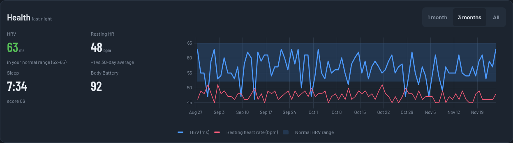</a>

- **Needs Garmin.** With Garmin connected ([see below](#garmin)), the health card shows last night's numbers.
- **HRV** against your normal range: Garmin's baseline, or else your own last 60 days. Green when it's in range, orange below, blue above.
- **Resting heart rate** against its 30-day average.
- **Sleep** (duration and score) and **Body Battery**.
- HRV with each night's normal range shaded, and resting heart rate: 1 month, 3 months or all.

### Calendar

<a href="img/training-calendar.png"></a>

- **Rides** have a solid bar. Rides from other sports carry a label, such as **Run**.
- **Planned workouts** have a dashed bar and show their planned TSS.
- **After the day**, a planned workout shows *planned 66 / actual 82 TSS* when you rode it (green), or red when you missed it.
- **Workouts planned on intervals.icu** carry an **intervals.icu** tag. One whose workout file can't be read shows *not readable*.
- **Phones** get a week list instead of the month grid ([see below](#phones)).

### A day

Click or tap a day to open it:

<a href="img/day-dialog.png">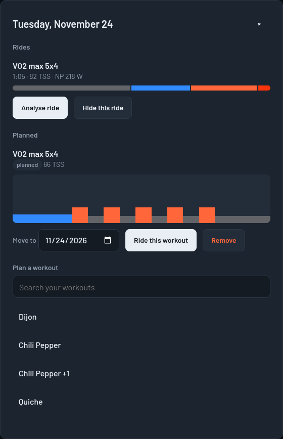</a>

- **The day's rides.** **Hide this ride** takes one out of every count without deleting it, which is useful for a duplicate the app didn't catch. It stays listed, greyed, with **Show** to bring it back.
- **The day's planned workouts.** Move them with the date field, or remove them.
- **Plan a workout.** Search your library and pick one. It shows up on the calendar right away, counts in the form forecast, and, with intervals.icu connected, appears there too.

On the day of a planned workout, the Ride page selects it when the app opens. It never does so over a workout you picked yourself that day, or during a ride. A saved ride is matched to that day's plan.

### A load for every workout

Fitness, fatigue and form need a training load (TSS) for every workout, also one without a power meter:

1. **Power**, when there is power.
2. **Heart rate**, against your threshold heart rate for the sport. Set it under *Settings*, or Garmin's value is used. Marked **HR**.
3. **How hard it was**: tap 1–10 in the day dialog. Marked **RPE**.
4. **An estimate** from the sport and duration (strength 30 an hour, a run 60), until you rate it. Marked **est.**

<a href="img/day-rating.png">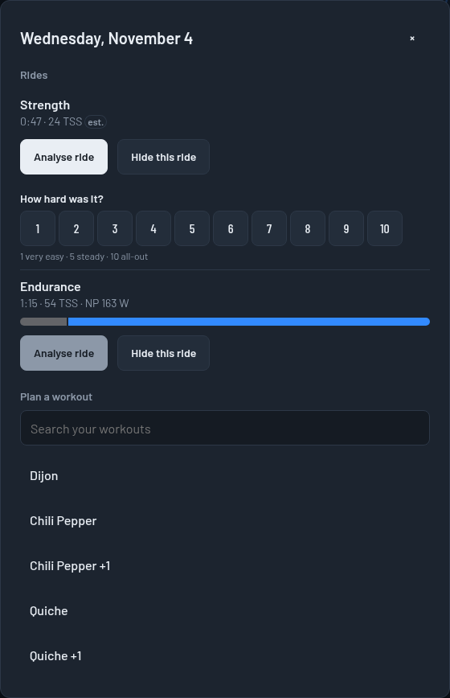</a>
<a href="img/settings-thresholds.png">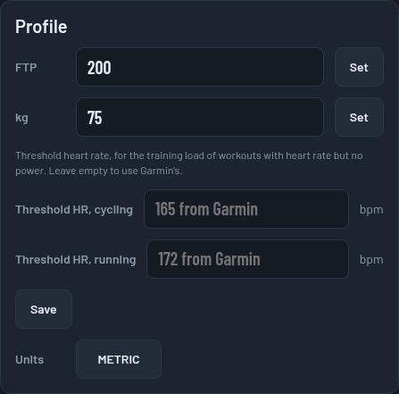</a>

### Progress

| | |
|---|---|
| <a href="img/progress-volume.png">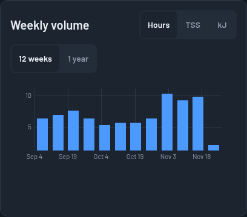</a> | <a href="img/progress-curve.png">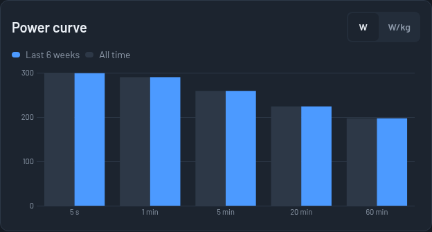</a> |
| <a href="img/progress-zones.png">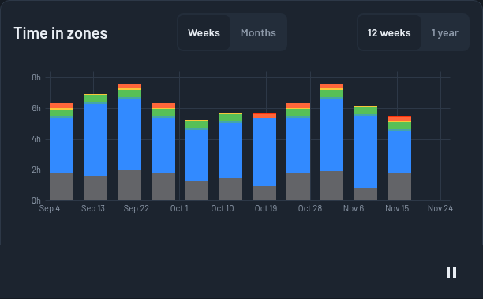</a> | <a href="img/progress-ftp.png"></a> |

- **Weekly volume**: hours, TSS or kJ for the last 12 weeks or the year.
- **Power curve**: your best 5 s, 1, 5, 20 and 60 min over the last 6 weeks against all time, in W or W/kg.
- **Time in zones**: per week or per month, the zones stacked.
- **FTP trend**: estimated from your best 20 and 60 minutes; the read-out names the effort each estimate comes from. When the estimate is more than 5 % off your FTP, the card offers to update it ("Use 213 W").

### Edit layout

<a href="img/training-edit.png">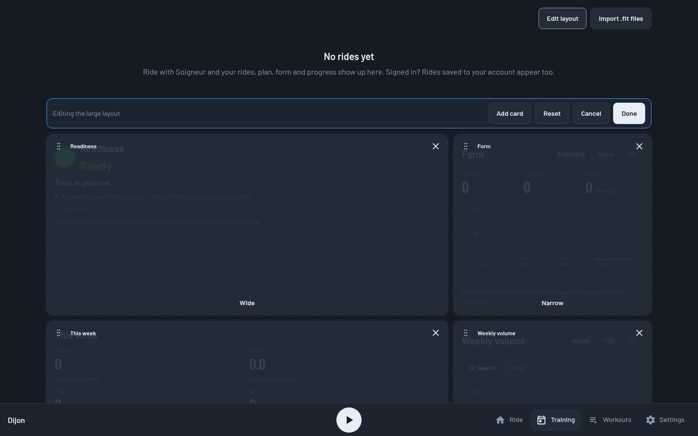</a>

*Edit layout* (top right) works on the Training page too: move the cards, make them *Narrow* (a third), *Wide* (two thirds) or *Full* width, remove cards you don't use and bring them back with *Add card*. On a phone every card is full width, so you only choose the order.

### Import .fit files

**Import .fit files** (top right of the Training page) adds rides recorded somewhere else, for example a Garmin export. Pick several files at once. Files already on the calendar are skipped, and files that can't be read are listed. Signed in, imported rides reach your other devices too.

## Ride analysis

<a href="img/analysis-desktop.png">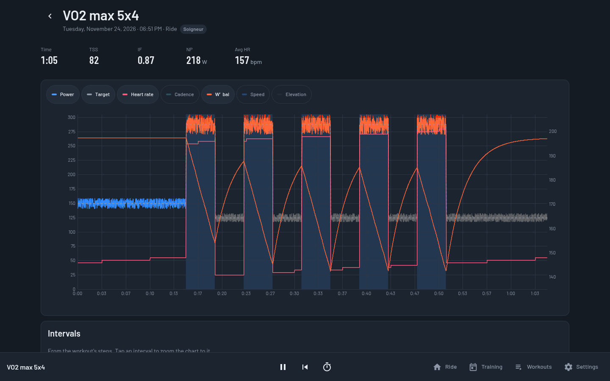</a>

**Analyse ride** in a day's dialog (and **Analyse** under *Workouts → Your rides*) opens a ride on its own page. It works for every ride: recorded in Soigneur, from Garmin, from intervals.icu, or an imported `.fit`. The back arrow returns to where you came from, and the page has its own link (`#ride=…`).

- **The chart:** power (coloured by zone), target, heart rate, cadence and W′bal; speed and elevation for an outdoor ride. Intervals are shaded. Hover (or touch) for a read-out per second, drag to zoom in, double-click to zoom out, and switch series on and off with the chips above it. Pauses stay gaps.
- **Where the file comes from:** a ride on this device is read here. Garmin and intervals.icu rides are fetched by your account server the first time you open them and kept there. intervals.icu doesn't hand out rides that came from Strava; the page says so and still shows the ride's summary.

<a href="img/analysis-intervals.png">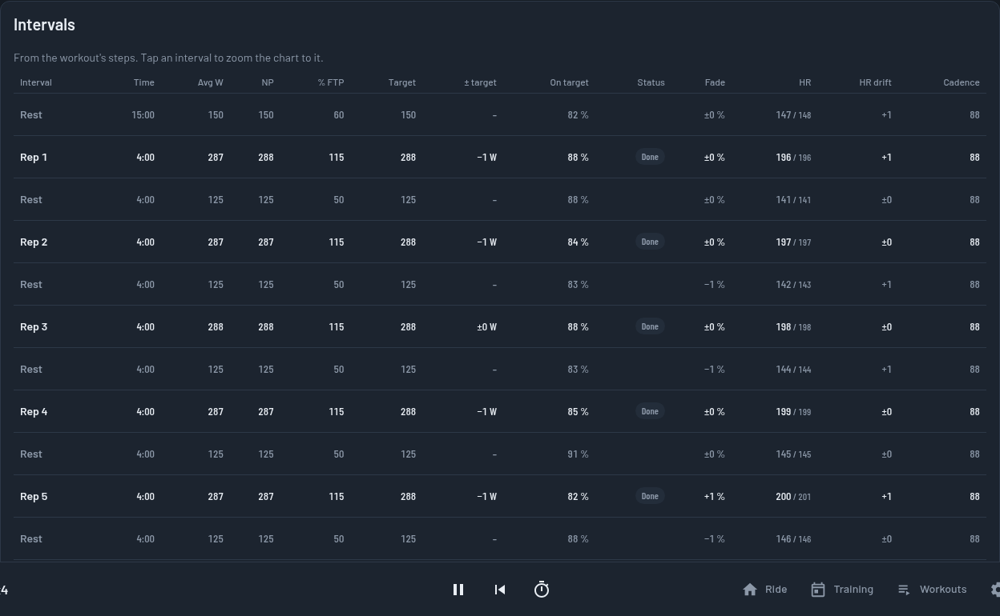</a>

- **Intervals:** from the workout you rode (planned against actual per rep: target, done, difference, time within 5 % of target, *Done*, *Cut short* or *Skipped*), else from the laps in the file, else found from your power (30 s or more at 88 % of FTP). Each row shows time, average power, NP, % FTP, fade (second half against first), heart rate and its drift, and cadence. Tap a row to zoom the chart to it. On a phone the rows are cards.

<a href="img/analysis-cards.png">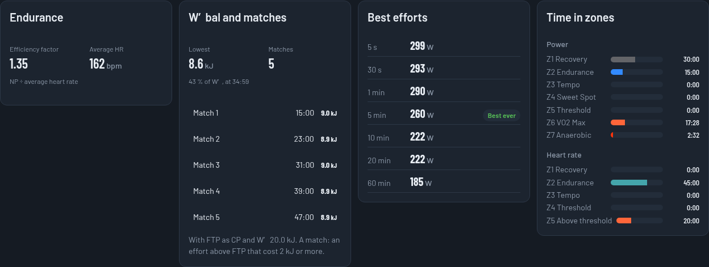</a>

- **Endurance:** decoupling (power per heartbeat, second half against first, the first 10 minutes left out; only on steady rides of 45 minutes or more) and efficiency factor (NP ÷ average heart rate).
- **W′bal and matches:** the lowest point and each match (an effort above FTP that cost 2 kJ or more); tap a match to zoom to it. The analysis uses the FTP the ride was ridden with.
- **Durability:** your best 5 and 20 minutes after 1,000, 2,000 and 3,000 kJ, against your best fresh in the same ride.
- **Best efforts** from 5 s to 60 min, marked *Best ever* or *Best in 6 weeks*, and **time in zones** for power and heart rate (from your threshold heart rate).

<a href="img/analysis-outdoor.png">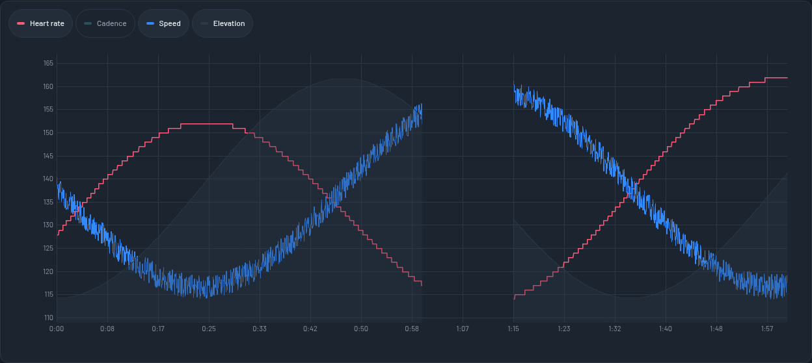</a>

A ride without power (most outdoor rides) shows heart rate, speed, elevation, heart-rate zones and laps; the power cards are left out.

| | |
|---|---|
| <a href="img/analysis-phone.png">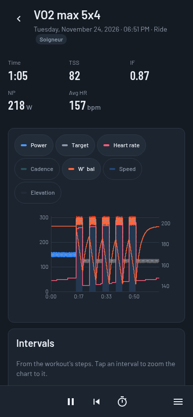</a> | |

## intervals.icu

Connect intervals.icu under *rider menu → Account* with your personal API key (intervals.icu → Settings → Developer Settings). The account server then does three things:

- **Uploads every new ride** to intervals.icu.
- **Brings in your activities**: the last 2 years on the first sync, then every 15 minutes. That covers outdoor rides, rides from other apps, and other sports.
  - All sports count for form, weekly volume and the calendar.
  - Power curve, FTP and zones use cycling only.
  - A ride recorded in Soigneur that is also on intervals.icu counts once. That holds whether it is Soigneur's own upload or a head unit that recorded the same ride, which the app recognises when the two overlap for at least 80 %.
- **Keeps the plan the same on both sides.**
  - A workout planned on intervals.icu appears on the Training calendar and can be ridden.
  - A workout planned in Soigneur appears on intervals.icu.
  - Moving or removing a workout on one side follows on the other. When both sides changed it, the newer change wins.

<a href="img/account.png"></a>

The card shows when it last synced, how many activities came in, and how many weren't available. Activities that reached intervals.icu from Strava come back empty through its API, so the card counts them instead. For those rides, use **Import .fit files**. **Sync now** starts a sync right away.

> The card in this screenshot is shown connected with a sample status. The walkthrough doesn't use a real intervals.icu account.

## Garmin

Connect Garmin under *rider menu → Account* with your Personal API key: Garmin Connect on the web, Settings, Personal API Key. Optionally enter the date the key expires; you get a warning a week before.

- **Health data**: every 15 minutes, 90 days back at first. That covers overnight HRV, resting heart rate, sleep, Body Battery, stress, weight and VO2max.
- **Activities**: 2 years back at first, then every 15 minutes, as a second source next to intervals.icu. A ride that arrives from several sources counts once: Soigneur's own recording, then Garmin, then imported `.fit`, then intervals.icu.
- **Threshold heart rate** per sport comes from your Garmin heart-rate zones, unless you set your own under *Settings*.
- The key is for your own data, stays on the server, and only reads: Garmin's personal key can't send workouts to the watch.

The Garmin card in the account picture above is shown connected with a sample status. The walkthrough doesn't use a real Garmin account.

## Workouts

<a href="img/workouts-desktop.png"></a>

- **The library** lists each workout with its type, duration and graph. Pick one with the round button; the ⋮ menu has more.
- **Load workouts** takes several files at once: `.zwo` (also as `.xml`), `.erg`, `.mrc`, intervals.icu workout text (`.txt`) and `.fit` courses. Files that can't be read are listed, and the rest still load.
- **The editor** builds your own workouts.
- **Your rides** lists the rides recorded on this device, for download.

## Riders and accounts

The rider pill at the top left opens the rider menu:

<a href="img/riders.png">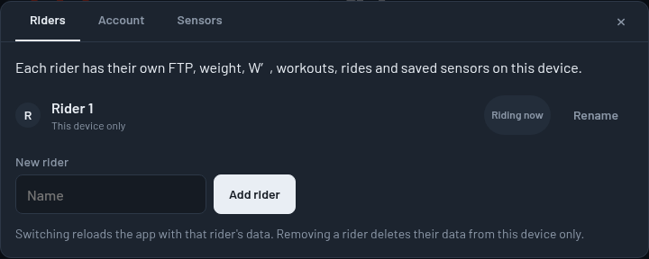</a>

- **Riders**: several riders on one device, each with their own FTP, weight, W′, workouts, rides and sensors.
- **Account**: sign in to your own account server (part of the Docker setup). That syncs your settings, workouts, rides, plan and hidden rides across devices. It also connects Strava, intervals.icu and Garmin Connect (*Send to Garmin* downloads the ride and opens Garmin's import page).
- **Sensors**: the saved trainer, heart-rate strap and other sensors, which reconnect by themselves.
- **Ride history**: every ride on the account, with `.fit` download, upload status per service and *Send to…*.
- **Users** (admins only): create accounts, reset passwords, change roles.

## Settings

<a href="img/settings-desktop.png">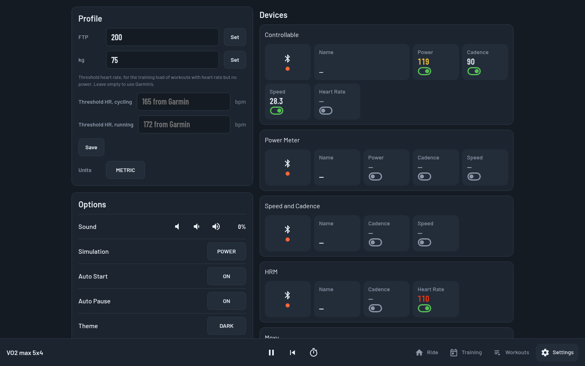</a>

- **The profile**: FTP, weight and the theme (dark, light or auto).
- **Every kind of sensor**: trainer, power meter, heart rate, Moxy, CoreTemp and more. Each one has its own switches for which data it provides.

## Phones

| Ride | Training | Calendar |
|---|---|---|
| <a href="img/ride-phone.png"></a> | <a href="img/training-phone.png">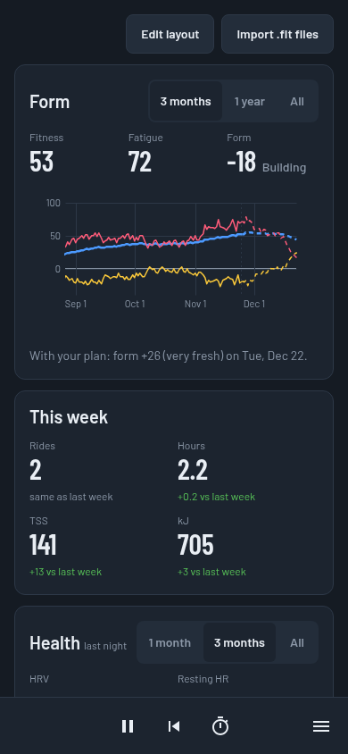</a> | <a href="img/training-phone-calendar.png">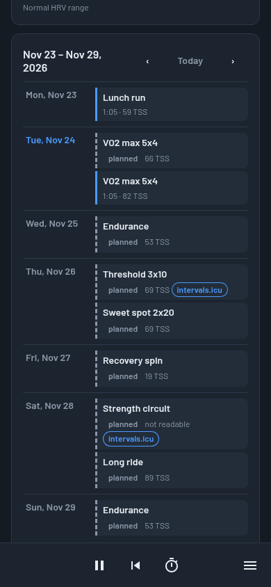</a> |

- **Riding on a phone**: everything you need fits on one screen, and the statistics below are swiped one at a time.
- **On the handlebars in landscape**: power, target, six metrics, the chart and the controls.
- **Training on a phone**: the calendar becomes a week list, so it stays readable.

## Light theme

<a href="img/training-desktop-light.png">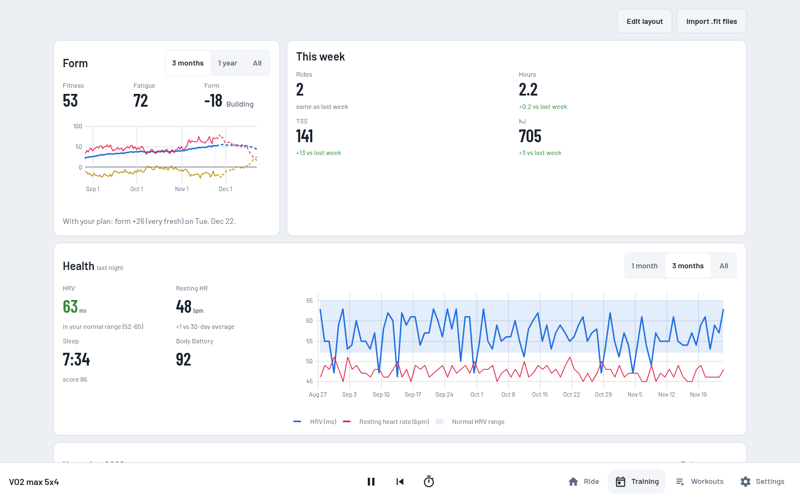</a>

Every page has a dark and a light version. *Auto* follows the system.

## Updating these pictures

With `npm start` running, and the account server pointing at a scratch database, because the script signs up a demo account:

```sh
DATA_DIR=/tmp/auuki-demo npm run server     # in a second terminal
CHROME_PATH=/path/to/chrome node docs/walkthrough/capture.js
```

The script writes `img/*.png`, `walkthrough.mp4` and `img/walkthrough.gif` (it needs `ffmpeg`). Use `--only shots` or `--only video` for one of them, and `--url` when the dev server runs on another port.
